# Veedu — build plan (for approval)

Status: **approved 2026-11-23** (with the Instagram change below). Phases 0–3 done; phase 4 built (needs Google Cloud steps). Next: phase 5. Live at https://veeduos.vercel.app
Based on `SPEC.md` (v3) and `reference/veedu-prototype.html`.

People: **Harsh** (owner) and **Prerna Nair** (partner).

---

## 1. Phase plan

Each phase ends with: CI green → commit (conventional message) → push → Vercel preview → I stop and send phone + desktop test steps.

| # | Phase | What you get | Your setup steps (click-by-click when we get there) |
|---|---|---|---|
| 0 | **Setup** | Next.js 16 + TS strict + Tailwind 4 skeleton, ESLint, Vitest, Playwright, GitHub Actions CI (lint · typecheck · unit · e2e), `.env.example`, README skeleton, DECISIONS log, keep-alive and backup workflows (dormant until Supabase exists) | Create Vercel (Hobby, via GitHub) and Supabase accounts; connect the repo to Vercel. Google Cloud / Gemini / Groq can wait until the phase that needs them. |
| 1 | **House shell** | Prototype ported to R3F modules; exterior → roof lift → cutaway; labels; tap-vs-drag; camera flights; desktop side panel + mobile bottom sheet with placeholder content; all routes (`/living` … `/backyard`, `/settings`); 2D floor-plan fallback (reduced motion, no WebGL, low FPS, manual toggle); loading screen with real progress; exterior idle drift | none (Vercel auto-deploys) |
| 2 | **Auth + household** | Supabase schema + RLS, Google sign-in, single-use 48 h invite, Prerna's onboarding, settings page, PWA install, push subscription, iOS "Add to Home Screen" guide | Create Supabase project; Google Cloud OAuth client; paste keys into Vercel + Supabase |
| 3 | **Core lists** | Shopping, tasks (+ subtasks), chores (RRULE, rotation, completion log, fairness line), notes board. Realtime + optimistic + soft delete/7-day trash. Fridge badge, laundry heap, nilavilakku driven by real data | none |
| 4 | **Calendar** | Google Calendar OAuth (offline, production consent), incremental sync via `syncToken` on `pg_cron` every 15 min + on app open, day/week/month views, milestones with auto labels + 14/7/1-day reminders, gift ideas, September planner | Enable Calendar API, set consent screen to *In production*, create/choose the "Us" calendar |
| 5 | **Dashboard** | Time-sensitive strip, merged Today, 7-day strip, pending, activity feed (last 20, pruned at 90 days), together-for-N-days counter | none |
| 6 | **Recipes** | Manual recipes, ratings, scaler, add-to-list with duplicate merge, JSON-LD import, Instagram import by **pasted caption or uploaded video** (no link downloading), review screen, Android share target, iOS paste flow | Gemini + Groq API keys; fine-grained GitHub token for `repository_dispatch`; GitHub Secrets |
| 7 | **Bedroom · backyard · closet** | Date ideas + Surprise me + memories timeline; trips, itinerary, bookings, packing, budget; vault with passkey/PIN re-unlock and encryption; petti glow, boat lantern, closet bell | Generate vault master key (I'll give a one-line command) |
| 8 | **Polish** | Roof opening over the nadumuttam, automatic Toronto-sunset evening mode, performance pass on your phone, accessibility audit, full Playwright suite, usage monitor (70 % warning), final README | Test on your real phone |

Phase 1 needs no backend at all, so you'll have the 3D house on your phone early.

---

## 2. Folder structure

```
houseos/
├─ SPEC.md · CLAUDE.md · README.md
├─ docs/  PLAN.md · DECISIONS.md · RESTORE.md
├─ reference/veedu-prototype.html        # untouched source of truth
├─ public/  manifest.webmanifest · icons/ · sw.js
├─ src/
│  ├─ app/
│  │  ├─ layout.tsx                      # fonts (next/font: Nunito Sans, Fraunces, Manjari), providers
│  │  ├─ (house)/[[...room]]/page.tsx    # "/", "/living", "/kitchen"… one page, room from the URL
│  │  ├─ settings/page.tsx
│  │  ├─ invite/[token]/page.tsx · onboarding/
│  │  ├─ share/route.ts                  # Web Share Target (Android)
│  │  └─ api/  calendar/oauth · imports · vault · push · export
│  ├─ scene/                             # three.js / R3F — ported from the prototype
│  │  ├─ textures/   (one file per CanvasTexture, cached registry, seeded RNG)
│  │  ├─ materials/  (M table, roof clones)
│  │  ├─ house/      (plinth, walls+openings, pillars, verandah, roof, mukhappu)
│  │  ├─ rooms/      (ROOMS config, floors, pick zones, highlight)
│  │  ├─ props/      (furniture per room, instanced books/slats/pillars)
│  │  ├─ garden/     (palms, bananas, hedge, pond+boat, well, compound wall)
│  │  ├─ camera/     (views, roomView, fly tween, idle drift, tap-vs-drag)
│  │  ├─ indicators/ (badges, heap, flames, lantern, bell, petti glow)
│  │  ├─ lighting/   (sun, hemi, lamps, day/evening)
│  │  └─ HouseCanvas.tsx                 # lazy-loaded with next/dynamic
│  ├─ floorplan/                         # 2D accessible SVG nalukettu map
│  ├─ panels/  PanelShell.tsx + one folder per room
│  ├─ features/  shopping · recipes · notes · tasks · chores · calendar · milestones · dates · trips · vault · activity
│  ├─ lib/  supabase/ · time/ (UTC ↔ America/Toronto) · rrule/ · crypto/ · ai/ (LLMProvider, Transcriber) · zod/
│  └─ styles/tokens.css                  # Tailwind 4 @theme tokens from spec §6
├─ supabase/
│  ├─ migrations/                        # schema, RLS, pg_cron jobs
│  ├─ functions/  calendar-sync · reminders · recurring-chores · cleanup · usage-report
│  └─ seed.sql                           # milestones + first-run examples
├─ worker/  import-recipe/               # Node script run inside GitHub Actions
├─ tests/  unit/ (Vitest) · e2e/ (Playwright, desktop + 375 px)
└─ .github/workflows/  ci.yml · import-recipe.yml · backup.yml · keepalive.yml
```

---

## 3. Database schema

Every household-owned table also has `household_id`, `created_by`, `created_at`, `updated_at`, `deleted_at` (omitted below to keep the diagram readable). RLS on every table: `household_id in (select household_id from members where user_id = auth.uid())`. Times are `timestamptz` (UTC); recurring-date fields (birthdays) are plain `date`.

"Assignee" fields are a member id, or `null` meaning **both**.

```mermaid
erDiagram
  HOUSEHOLDS ||--|{ MEMBERS : has
  HOUSEHOLDS ||--o{ INVITES : issues
  HOUSEHOLDS ||--|| HOUSEHOLD_SETTINGS : configures
  MEMBERS ||--|| NOTIFICATION_PREFS : sets
  MEMBERS ||--o{ PUSH_SUBSCRIPTIONS : registers
  HOUSEHOLDS ||--o{ SCHEDULED_NOTIFICATIONS : queues

  HOUSEHOLDS ||--o{ NOTES : pins
  HOUSEHOLDS ||--o{ ACTIVITY_LOG : records

  HOUSEHOLDS ||--o{ SHOPPING_ITEMS : lists
  HOUSEHOLDS ||--o{ ITEM_FREQUENCY : learns
  HOUSEHOLDS ||--o{ RECIPES : keeps
  RECIPES ||--o{ RECIPE_INGREDIENTS : uses
  RECIPES ||--o{ RECIPE_STEPS : follows
  RECIPES ||--o{ RECIPE_RATINGS : rated
  RECIPE_IMPORT_JOBS |o--o| RECIPES : produces

  HOUSEHOLDS ||--o{ DATE_IDEAS : dreams
  DATE_IDEAS ||--o{ DATE_MEMORIES : becomes
  DATE_MEMORIES ||--o{ DATE_RATINGS : rated

  MEMBERS ||--o{ CALENDAR_ACCOUNTS : connects
  CALENDAR_ACCOUNTS ||--o{ CALENDAR_SOURCES : lists
  CALENDAR_SOURCES ||--o{ CALENDAR_EVENT_CACHE : caches
  HOUSEHOLDS ||--o{ MILESTONES : celebrates
  MILESTONES ||--o{ GIFT_IDEAS : inspires
  HOUSEHOLDS ||--o{ TASKS : tracks
  TASKS ||--o{ SUBTASKS : splits

  HOUSEHOLDS ||--o{ CHORES : schedules
  CHORES ||--o{ CHORE_COMPLETIONS : logs

  HOUSEHOLDS ||--o{ VAULT_ITEMS : stores
  MEMBERS ||--o{ WEBAUTHN_CREDENTIALS : unlocks
  MEMBERS ||--o| VAULT_PINS : fallback

  HOUSEHOLDS ||--o{ TRIPS : plans
  TRIPS ||--o{ TRIP_DAYS : spans
  TRIP_DAYS ||--o{ TRIP_ITINERARY_ITEMS : contains
  TRIPS ||--o{ TRIP_BOOKINGS : books
  TRIPS ||--o{ TRIP_EXPENSES : spends
  TRIPS ||--o{ PACKING_ITEMS : packs
  HOUSEHOLDS ||--o{ PACKING_TEMPLATES : reuses
  HOUSEHOLDS ||--o{ USAGE_REPORTS : monitors

  HOUSEHOLDS {
    uuid id PK
    text name
    date together_since
  }
  MEMBERS {
    uuid id PK
    uuid household_id FK
    uuid user_id FK
    text display_name
    text role
    text color_token
  }
  INVITES {
    uuid id PK
    text token_hash
    timestamptz expires_at
    timestamptz used_at
  }
  HOUSEHOLD_SETTINGS {
    uuid household_id PK
    jsonb room_labels
    text evening_mode
    text timezone
  }
  NOTIFICATION_PREFS {
    uuid member_id PK
    time quiet_start
    time quiet_end
    jsonb kinds
    bool three_d_enabled
  }
  PUSH_SUBSCRIPTIONS {
    uuid id PK
    uuid member_id FK
    text endpoint
    text p256dh
    text auth
  }
  SCHEDULED_NOTIFICATIONS {
    uuid id PK
    uuid member_id FK
    text kind
    text route
    timestamptz send_at
    timestamptz sent_at
  }
  NOTES {
    uuid id PK
    text body
    text color
    bool pinned
    timestamptz expires_at
    timestamptz archived_at
  }
  ACTIVITY_LOG {
    uuid id PK
    uuid actor_id FK
    text verb
    text entity_type
    uuid entity_id
    text summary
  }
  SHOPPING_ITEMS {
    uuid id PK
    text name
    text normalized_name
    numeric qty
    text unit
    text store
    text category
    timestamptz checked_at
    uuid source_recipe_id FK
  }
  ITEM_FREQUENCY {
    text normalized_name PK
    int times_added
    text last_store
    timestamptz last_added_at
  }
  RECIPES {
    uuid id PK
    text title
    text photo_path
    int prep_min
    int cook_min
    int servings
    text_array tags
    text source_url
    text creator_credit
  }
  RECIPE_INGREDIENTS {
    uuid id PK
    uuid recipe_id FK
    int position
    numeric qty
    text unit
    text item
    real confidence
  }
  RECIPE_STEPS {
    uuid id PK
    uuid recipe_id FK
    int position
    text body
  }
  RECIPE_RATINGS {
    uuid recipe_id PK
    uuid member_id PK
    int rating
    text note
  }
  RECIPE_IMPORT_JOBS {
    uuid id PK
    text kind
    text source_url
    text status
    jsonb draft
    jsonb field_confidence
    text error
  }
  DATE_IDEAS {
    uuid id PK
    text title
    text notes
    text link
    text location
    text_array tags
    int cost_level
    text duration
    text status
    timestamptz planned_for
    text calendar_event_id
  }
  DATE_MEMORIES {
    uuid id PK
    uuid date_idea_id FK
    date happened_on
    text photo_path
    text memory_note
  }
  DATE_RATINGS {
    uuid memory_id PK
    uuid member_id PK
    int rating
  }
  CALENDAR_ACCOUNTS {
    uuid id PK
    uuid member_id FK
    text google_email
    bytea refresh_token_enc
    text status
  }
  CALENDAR_SOURCES {
    uuid id PK
    uuid account_id FK
    text google_calendar_id
    text summary
    bool visible
    bool is_us_calendar
    text sync_token
    timestamptz last_synced_at
  }
  CALENDAR_EVENT_CACHE {
    uuid id PK
    uuid source_id FK
    text google_event_id
    text etag
    text summary
    timestamptz starts_at
    timestamptz ends_at
    bool all_day
    text status
  }
  MILESTONES {
    uuid id PK
    text title
    text kind
    date base_date
    uuid person_id FK
    int_array remind_days
  }
  GIFT_IDEAS {
    uuid id PK
    uuid milestone_id FK
    text title
    text link
    numeric price
    text status
  }
  TASKS {
    uuid id PK
    text title
    text notes
    timestamptz due_at
    uuid assignee_id FK
    int priority
    text visibility
    timestamptz completed_at
  }
  SUBTASKS {
    uuid id PK
    uuid task_id FK
    text title
    bool done
    int position
  }
  CHORES {
    uuid id PK
    text title
    text rrule
    timestamptz dtstart
    text assignment_mode
    uuid assignee_id FK
    timestamptz next_due_at
  }
  CHORE_COMPLETIONS {
    uuid id PK
    uuid chore_id FK
    uuid completed_by FK
    timestamptz due_at
    timestamptz completed_at
  }
  VAULT_ITEMS {
    uuid id PK
    text section
    text label
    jsonb public_fields
    bytea secret_ciphertext
    bytea wrapped_dek
    date renewal_date
    text attachment_path
  }
  WEBAUTHN_CREDENTIALS {
    uuid id PK
    uuid member_id FK
    text credential_id
    bytea public_key
    bigint counter
  }
  VAULT_PINS {
    uuid member_id PK
    text pin_hash
    int failed_attempts
  }
  TRIPS {
    uuid id PK
    text title
    text destination
    date starts_on
    date ends_on
    text cover_path
    numeric budget_planned
  }
  TRIP_DAYS {
    uuid id PK
    uuid trip_id FK
    date day_date
  }
  TRIP_ITINERARY_ITEMS {
    uuid id PK
    uuid trip_day_id FK
    time at_time
    text title
    text notes
  }
  TRIP_BOOKINGS {
    uuid id PK
    uuid trip_id FK
    text kind
    text title
    text confirmation_no
    timestamptz starts_at
    text attachment_path
  }
  TRIP_EXPENSES {
    uuid id PK
    uuid trip_id FK
    numeric amount
    text category
    uuid paid_by FK
  }
  PACKING_ITEMS {
    uuid id PK
    uuid trip_id FK
    uuid owner_id FK
    text title
    bool packed
  }
  PACKING_TEMPLATES {
    uuid id PK
    text title
    jsonb items
  }
  USAGE_REPORTS {
    uuid id PK
    bigint db_bytes
    bigint storage_bytes
    timestamptz measured_at
  }
```



Additions beyond the spec's minimum list, and why:
- `calendar_sources` — `syncToken` and "which calendars to show" are per calendar, not per account.
- `item_frequency` — quick-add suggestions must survive the 7-day trash purge.
- `recipe_ratings`, `date_ratings` — one rating per person, cleanly.
- `trip_itinerary_items`, `trip_expenses` — itinerary entries and "spent" for the budget.
- `webauthn_credentials`, `vault_pins` — vault re-unlock.
- `scheduled_notifications` — one queue that reminders, milestones and chores all write to; a 5-minute `pg_cron` job sends due ones while respecting quiet hours.
- `usage_reports` — the monthly free-tier monitor.

---

## 4. Cost table

Limits are the published free tiers as I understand them; I'll re-check each one on the day you create the account and correct this table.

| Service | Free tier (approx.) | Our expected use | Cost |
|---|---|---|---|
| Vercel Hobby | 100 GB transfer/mo, generous function invocations; non-commercial only | 2 people; maybe 1–2 GB/mo | $0 |
| Supabase Free | 500 MB DB, 1 GB storage, 5 GB egress, 500k Edge Function calls/mo, 200 realtime connections; pauses after 7 days idle | DB < 50 MB; storage ~200–400 MB in year one (WebP photos ≈200 KB); ~9k function calls/mo for reminders now (every 5 min), ~15k once calendar sync is added | $0 |
| GitHub (private repo) | 2,000 Actions minutes/mo; 500 MB artifact storage | CI ~3–5 min/push (Playwright browser cached), imports ~3–4 min each, backups ~2 min/wk, keep-alive <1 min. Estimate 600–1,000 min/mo | $0 |
| Google Cloud (OAuth + Calendar API) | Calendar API quota is free (1M queries/day); unverified app OK up to 100 users | 2 users, a few thousand calls/day | $0 |
| Google AI Studio (Gemini Flash, free tier) | rate-limited (per-minute and per-day caps) | ≤20 imports/day, usually a handful/week | $0 |
| Groq (Whisper, free tier) | daily request + audio-seconds caps | ~1–3 min of audio per reel | $0 |
| whisper.cpp in Actions (fallback) | Actions minutes only | only if Groq fails | $0 |
| Web Push (VAPID) | browser push services are free | a few pushes/day | $0 |
| Fonts (Google Fonts via `next/font`) | free, self-hosted | — | $0 |
| Domain | `*.vercel.app` | — | $0 |
| Optional: Claude Haiku | pay-per-use, hard spend cap | **off** unless you add a key | $0 (≤$2 if enabled) |
| **Total** | | | **$0/month** |

Biggest pressure point: **GitHub Actions minutes** on a private repo. I'll keep CI lean (cached deps and browsers, Playwright only on `main` and PRs, skip CI for docs-only commits) and report minutes in the usage monitor.

---

## 5. Prototype port plan

**Reuse as-is (same numbers, same look):**
- All constants and coordinates: `P = 0.45`, `WH = 3.0`, `CUT = 0.4`, plinth, the `ROOMS` bounds, courtyard `CX0..CZ1`, wall runs with the same openings, window positions, pillars, verandah, charupadi, every furniture placement, palms/bananas/pond/well placements.
- Every procedural texture drawing function, verbatim, with the same seeded RNG (`seed = 11`, Park–Miller), so the textures come out pixel-identical.
- The material table `M` and the UV-tiling helper (`scaleBoxUV`, `flat`).
- `hipRoof`, mukhappu gable, verandah lean-to, the roof-lift/fade + wall-cutaway tween, `views()`, `roomView()` including the portrait/wide offsets, easing, 7 px tap threshold, orbit limits, evening light values, badge sprite drawing.
- Panel look: kasavu band, cream paper, brass border, type sizes — moved into Tailwind tokens.

**Restructure:**
- Imperative `box()/cyl()` calls → typed data + small R3F components in `scene/*`. A unit test checks the room-bounds table against the spec footprints.
- **Draw calls:** the prototype creates several hundred separate meshes. Static, non-pickable geometry will be merged per material (`BufferGeometryUtils.mergeGeometries`); pillars, bench slats, books, palms, fronds and lily pads become `InstancedMesh`. Target: under 120 draw calls.
- Textures generated once into a cache keyed by name, and created only after the loading screen starts, which also drives its progress bar.
- r128 → current three.js: `outputEncoding`/`sRGBEncoding` → `outputColorSpace`/`SRGBColorSpace`; `texture.encoding` → `colorSpace`; `mergeBufferGeometries` → `mergeGeometries`; light intensities adjusted for the physically-correct lighting default (values re-tuned so it looks the same).
- Tween list → one camera controller with its own clock; the label DOM overlay becomes drei `<Html>` or a single projected overlay layer (whichever is cheaper on mobile).
- The in-file HTML panels and demo data → React panels with placeholder content (phase 1), then real data.
- Route ↔ room: URL drives the selected room; `laundry` key becomes `wash` to match `/wash`.
- Mobile: DPR capped at 2, shadow map 1024 on mobile / 2048 desktop.

**Where the spec and the prototype disagree (I'll follow the spec):**
1. Panel animation is 450 ms in the prototype; the spec says 150–250 ms. I'll use ~220 ms (camera stays at ~950 ms).
2. Vault PIN is 4 digits in the prototype; the spec says 6.
3. Evening mode is manual-only in the prototype; the spec wants automatic Toronto sunset plus an override.
4. Fonts load from the Google CDN in the prototype; the spec says self-host via `next/font`.
5. The prototype has no roof opening over the nadumuttam, idle drift or real loading progress; idle drift and loading go in phase 1, the roof opening in phase 8.
6. The prototype's internal key is `laundry`; the route is `/wash`.

---

## 6. Questions and risks

**Questions for you** — answered 2026-11-23: (1) show names "Harsh" / "Prerna"; (2) repo stays private; (3) the app creates the "Us" calendar in Harsh's account and shares it with Prerna; (4) both in America/Toronto.

1. **Names in the UI.** I suggest showing **"Harsh"** and **"Prerna"** (chips, "updated by Prerna just now") instead of the prototype's "You / Her". Each device can still say "You" for its own user if you prefer. Which do you want?
2. **Repo visibility.** The spec says private (2,000 free Actions min/mo). Fine with that budget, or would you make the repo public for unlimited minutes? (Secrets stay safe either way, but your code and plan would be visible.) I recommend staying private.
3. **The "Us" calendar.** Do you already have a shared Google calendar, or should the app create one in your account and share it with Prerna?
4. **Both in Toronto?** I'm assuming you both live in America/Toronto. Is that right?

**Risks**
1. ~~Instagram downloads from GitHub runners will often fail.~~ **Resolved:** Harsh chose caption-paste / video-upload only. The app never downloads from Instagram; a pasted reel link is kept only as the source credit. The uploaded video still runs through the GitHub Actions pipeline (ffmpeg → transcribe → structure), capped at 60 imports a month.
2. **Gemini free tier and data use.** Google may use free-tier prompts to improve its products. We only ever send recipe content (caption, transcript, frames), never vault, notes or calendar data, so I think this is acceptable. Tell me if not.
3. **Vault encryption model.** The plan: AES-256-GCM envelope encryption on the server (per-item data key wrapped by a master key kept only in Vercel and Supabase secrets, never in the database). Unlocking needs passkey or PIN and gives a 5-minute session. This protects against a database leak or a lost backup. It does **not** protect against someone who controls the Vercel account, which is an inherent limit of a $0 setup without end-to-end encryption. Fine for Wi-Fi passwords and policy numbers; I'd avoid storing bank passwords.
4. **Google OAuth "unverified app" screen.** With the consent screen set to *In production* but unverified, you'll both see a "Google hasn't verified this app" warning once and click through. That's expected and free.
5. **Supabase direct DB connections are IPv6-only on the free tier**, and GitHub runners are IPv4. The backup job will use the session pooler connection string. I'll document this in the restore guide.
6. **Backups:** I recommend keeping the encrypted dumps as workflow artifacts (60-day retention, about 8 kept) rather than in a git branch, which would grow the repo forever.
7. **iOS limits:** push only after "Add to Home Screen" (iOS 16.4+), no share target, and passkeys need Safari or the installed PWA. All are planned for, but test on Prerna's phone if she's on iPhone.
8. **3D on mid-range phones:** the prototype is heavy on draw calls. The merge/instancing pass plus the low-FPS fallback should keep it ≥30 fps, which we'll check on your real phone in phases 1 and 8.

**A simplification:** you don't need Node installed on your computer. I build and test here in the cloud, and you test on the Vercel preview URL. Install Node and git locally only if you want to run it yourself.

---

## 7. Proposed library versions (latest stable at planning time)

Next.js 16 · React 19 · TypeScript (strict) · Tailwind CSS 4 · three.js r187 · @react-three/fiber 9 · @react-three/drei 10 · @supabase/supabase-js 2 · TanStack Query 5 · Zod 4 · Framer Motion · rrule · @simplewebauthn · web-push · Vitest · Playwright. All MIT/Apache-licensed and free.
